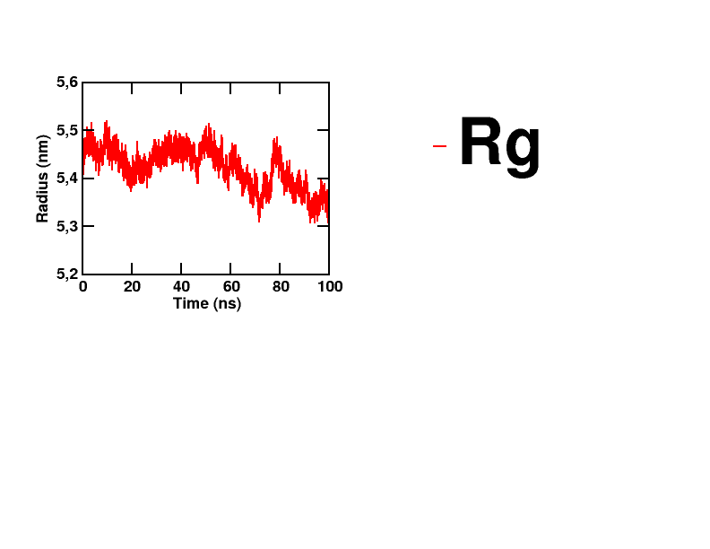

# XMGrace XVG/DAT Plotter

A Bash script for automatically generating PNG plots from XVG and DAT files using XMGrace.

This tool is useful for visualizing molecular dynamics simulation results, particularly data generated by GROMACS.

## Features

- Generate PNG plots from XVG and DAT files.
- Automatically process multiple XVG files in a directory.
- Apply consistent formatting to plots.
- Generate corresponding DAT output when processing XVG files.
- Support single-file and batch processing.

## Requirements

- Linux
- Bash
- XMGrace (xmgrace, gracebat, or grace)

## Usage

### Make the script executable

    chmod +x plot_xmgrace_all_dat_png.sh

### Process a single XVG file

    ./plot_xmgrace_all_dat_png.sh rmsd.xvg

### Process a single DAT file

    ./plot_xmgrace_all_dat_png.sh rmsd.dat

### Process all XVG files in the current directory

    ./plot_xmgrace_all_dat_png.sh

## Applications

Useful for plotting GROMACS molecular dynamics analysis results, including:

- RMSD
- RMSF
- Radius of gyration (Rg)
- Solvent-accessible surface area (SASA)
- Other XVG and DAT datasets

## Notes

The script requires XMGrace to be installed. It can be used directly from the directory containing the input files.

## Example Output

The following radius of gyration (Rg) plot was generated
using the script from GROMACS simulation data.

The script can be used to generate similarly formatted plots
for RMSD, RMSF, SASA, and other simulation analysis results.
